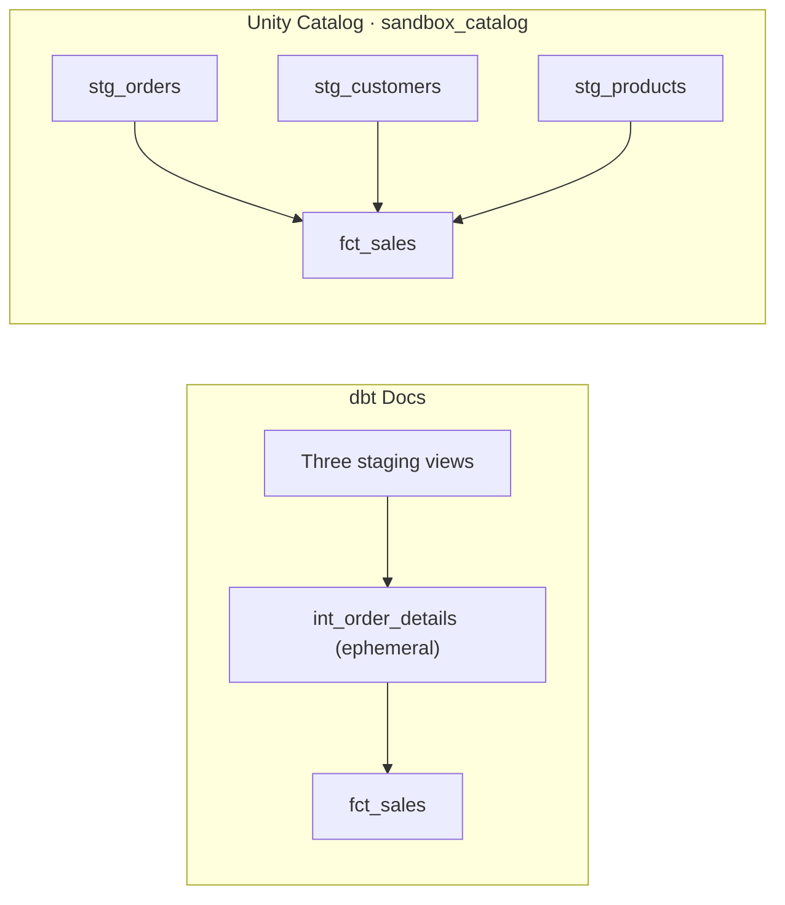
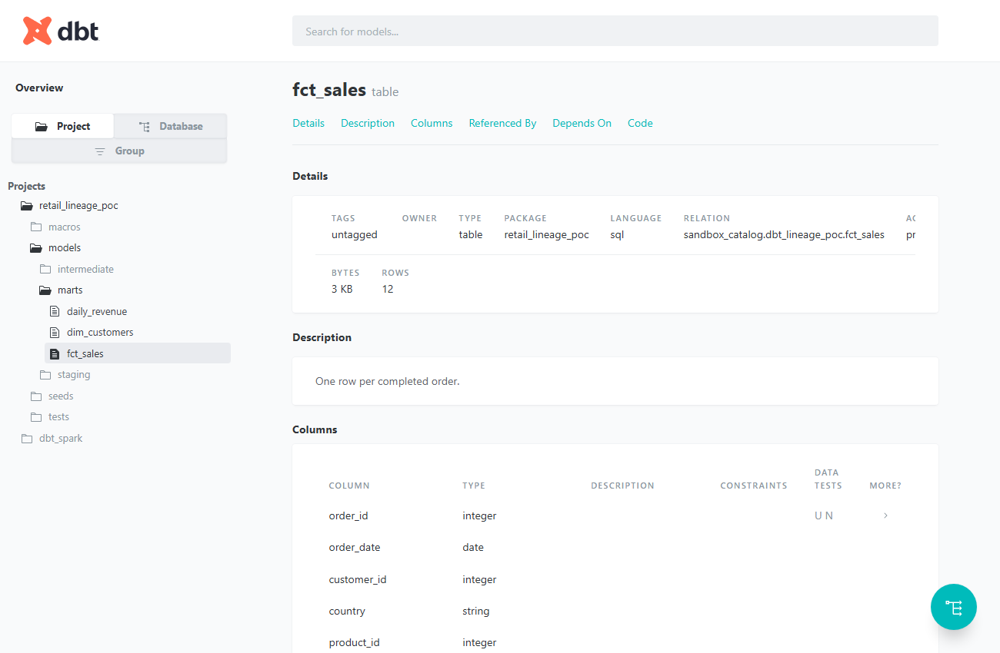
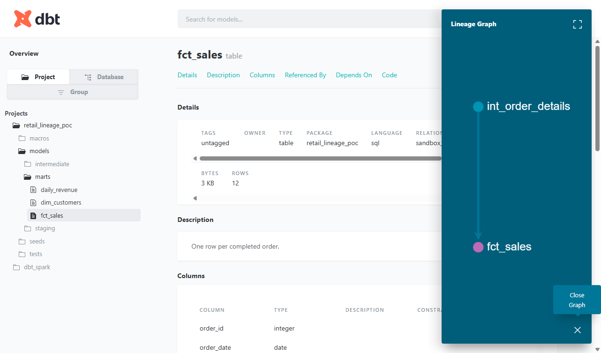
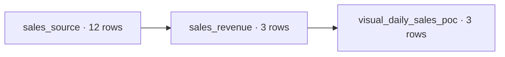

# Verified findings

The diagrams are redrawn from observed graphs using the generic catalog name `sandbox_catalog`.

## dbt and Unity Catalog

The retail baseline built three seed tables, three staging views and three marts. All 19 tests passed. dbt Docs showed the ephemeral `int_order_details` as a parent of `fct_sales`. After metadata access was granted, Catalog Explorer showed direct edges from the three staging views. System lineage tables were unavailable to the test identity. Column-level mappings and the exact privilege grants remain unverified.

## Lakeflow Designer

Designer read the dbt-built mart and wrote a separate table. The Lakeflow Job showed all three operators succeeding. Delta history confirmed the job write. Catalog Explorer showed the saved canvas and job as producers after metadata access was granted. The direct source-to-output table edge remains unverified.

| Category | Verified revenue |
|---|---:|
| Accessories | 52.50 |
| Home | 69.75 |
| Stationery | 63.00 |

A parameterized reference successfully read a dbt-built view. A SQL preview with raw dbt `ref()` failed with an unresolved template expression. The documented import format is `.designer.ipynb`. Compiled SQL parity, macro evaluation and workspace import probes remain open.

## Native dbt job and Dagster

| Experiment | Verified result |
|---|---|
| Native Lakeflow dbt job | One task, nine successful resources and 19 tests passing. The artifact archive included `manifest.json` and `run_results.json`. |
| Dagster full build | Nine asset materializations and 19 passing checks. |
| Dagster selective build | Selecting `fct_sales` and its upstream assets yielded seven materializations and 15 passing checks. |
| Dagster failure | An invalid column in `stg_orders` failed the run. Independent branches materialized, and all three marts skipped. |
| Dagster recovery | The original SQL materialized all nine assets and passed all 19 checks. |

## Reproduce the checks

- [ ] Build the retail project and inspect dbt Docs.
- [ ] Check table and column lineage in Catalog Explorer.
- [ ] Run the Designer canvas, compare values, and inspect the producers.
- [ ] Compare the native dbt job and local Dagster.
- [ ] Try the [policy lab](dbt-lineage-poc-pilot/README.md).