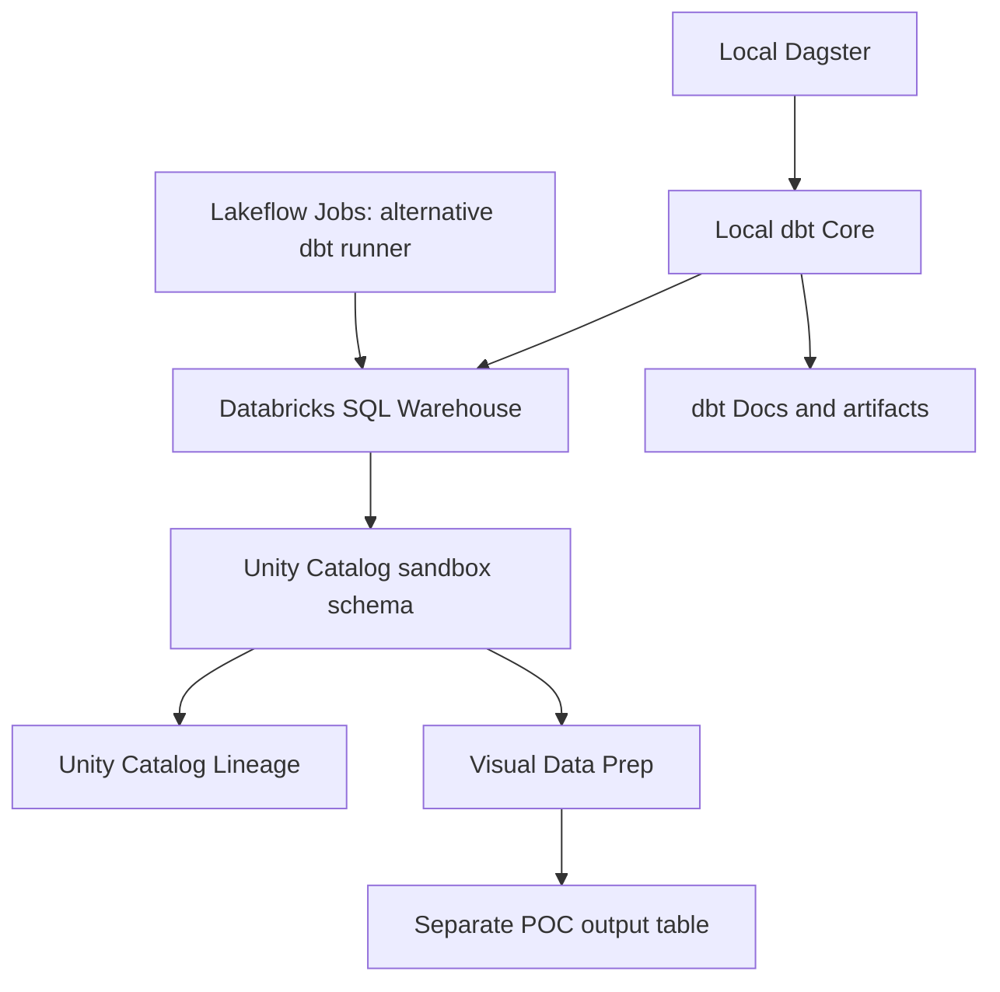

# dbt + Databricks + Dagster — POC technical guide

Supporting reference for AGENTS.md. Keep the implementation lean. Examples are illustrative; verify package APIs and workspace capabilities before implementation. Expected findings are hypotheses, not verified results.

## 4. Expected repository structure

```text
dbt-databricks-lineage-poc/
├── AGENTS.md
├── POC_GUIDE.md
├── README.md
├── FINDINGS.md
├── requirements.txt
├── .env.example
├── .gitignore
├── dbt_project/
│   ├── dbt_project.yml
│   ├── profiles.yml.example
│   ├── seeds/
│   │   ├── raw_customers.csv
│   │   ├── raw_orders.csv
│   │   └── raw_products.csv
│   ├── models/
│   │   ├── staging/
│   │   │   ├── stg_customers.sql
│   │   │   ├── stg_orders.sql
│   │   │   ├── stg_products.sql
│   │   │   └── schema.yml
│   │   ├── intermediate/int_order_details.sql
│   │   └── marts/
│   │       ├── fct_sales.sql
│   │       ├── dim_customers.sql
│   │       ├── daily_revenue.sql
│   │       └── schema.yml
│   ├── macros/calculate_amount.sql
│   └── tests/positive_order_quantity.sql
├── orchestration/definitions.py
├── sql/unity_catalog_lineage.sql
├── scripts/inspect_manifest.py
└── docs/
    ├── visual_data_prep.md
    └── databricks_jobs.md
```

## 5. Architecture



One dbt codebase, one SQL Warehouse, alternative execution mechanisms and multiple lineage views. Dagster invokes dbt; Databricks executes the SQL. Do not run alternative runners concurrently against the same schema.

## 6. Run the baseline POC

Prerequisites: workspace hostname, SQL Warehouse HTTP path, approved authentication, authorised sandbox catalog, schema creation/object permissions, and Lakeflow Designer access if enabled.

Windows PowerShell:

```powershell
python -m venv .venv
.venv\Scripts\Activate.ps1
pip install -r requirements.txt
```

Mac/Linux activation: `source .venv/bin/activate`.

Core dependencies: dbt-core, dbt-databricks, dagster, dagster-webserver, dagster-dbt. Resolve compatible versions and pin tested versions.

Example profiles.yml (PAT only if permitted; document approved OAuth alternative):

```yaml
retail_lineage_poc:
  target: dev
  outputs:
    dev:
      type: databricks
      catalog: "{{ env_var('DATABRICKS_CATALOG') }}"
      schema: "{{ env_var('DATABRICKS_SCHEMA') }}"
      host: "{{ env_var('DATABRICKS_HOST') }}"
      http_path: "{{ env_var('DATABRICKS_HTTP_PATH') }}"
      token: "{{ env_var('DATABRICKS_TOKEN') }}"
      threads: 4
```

Use a single sandbox schema, e.g. `sandbox.dbt_lineage_poc`. Load environment variables into the shell; an .env file alone does not do this. Keep credentials outside Git. Put the actual profile in the standard dbt profile directory or configure the same explicit profiles directory for dbt and Dagster.

```bash
cd dbt_project
dbt debug
dbt parse
dbt build
dbt docs generate
dbt docs serve
```

Open dbt Docs (typically localhost:8080) and inspect upstream/downstream dependencies. Save manifest.json, run_results.json and catalog.json as appropriate; preserve the build run results before later dbt commands can overwrite them.

| Expected object | Type |
|---|---|
| raw_customers | Table |
| raw_products | Table |
| raw_orders | Table |
| stg_customers | View |
| stg_products | View |
| stg_orders | View |
| int_order_details | Ephemeral, no standalone object |
| fct_sales | Table |
| dim_customers | Table |
| daily_revenue | Table |

Nine persistent objects and one ephemeral model.

## 7. Unity Catalog lineage

Open Catalog Explorer > sandbox > dbt_lineage_poc > fct_sales > Lineage. Repeat for dim_customers and daily_revenue.

```sql
SELECT DISTINCT
    source_table_full_name AS upstream,
    target_table_full_name AS downstream
FROM system.access.table_lineage
WHERE source_table_full_name IS NOT NULL
  AND target_table_full_name IS NOT NULL
  AND (source_table_full_name LIKE 'sandbox.dbt_lineage_poc.%'
    OR target_table_full_name LIKE 'sandbox.dbt_lineage_poc.%')
ORDER BY downstream, upstream;
```

```sql
SELECT DISTINCT
    source_table_full_name,
    source_column_name,
    target_table_full_name,
    target_column_name
FROM system.access.column_lineage
WHERE target_table_full_name = 'sandbox.dbt_lineage_poc.fct_sales';
```

Replace sandbox with the actual catalog. System table access may require additional permissions.

Compare the logical chain `stg_orders -> int_order_details -> fct_sales` with runtime lineage. The ephemeral model is inlined, so it has no independent Unity Catalog object. Exact physical edges may vary with view expansion and execution. Record actual results, including missing edges, column lineage and any access limitations.

## 8. Visual Data Prep experiments

### A. Consume existing dbt outputs

Create a Lakeflow Designer file with Source (fct_sales) -> SQL/Aggregate -> Output (visual_daily_sales_poc, a separate table). Name the source sales_source.

```sql
SELECT category, SUM(gross_amount) AS total_revenue
FROM sales_source
GROUP BY category
```

Adapt to actual operator naming. Run and inspect downstream Unity Catalog lineage. Never overwrite dbt tables.

### B. Try dbt syntax and compiled SQL

Test this SQL operator input:

```sql
SELECT * FROM {{ ref('stg_orders') }}
```

Then connect an orders_source operator and try:

```sql
SELECT * FROM orders_source
```

Also try a dbt macro and compiled SELECT SQL (adapt references to source operator names). Record whether each works and whether results agree with dbt.

### C. Test native dependency support

- Does selecting an existing dbt table expose the complete dbt DAG inside the Designer canvas?
- Can it import manifest.json or an entire dbt project?
- Can it resolve ref(), Jinja and macros without external compilation?
- Can it reuse compiled SQL without extensive adaptation?

Treat missing or undocumented capabilities as unverified until tested. Distinguish the Designer's own operator graph from Unity Catalog lineage and the logical dbt DAG.

## 9. Dagster integration

Illustrative minimal orchestration/definitions.py:

```python
from pathlib import Path
from dagster import Definitions
from dagster_dbt import DbtCliResource, dbt_assets

ROOT = Path(__file__).resolve().parents[1]
DBT_PROJECT = ROOT / 'dbt_project'

@dbt_assets(manifest=DBT_PROJECT / 'target' / 'manifest.json')
def retail_dbt_assets(context, dbt: DbtCliResource):
    yield from dbt.cli(['build'], context=context).stream()

defs = Definitions(
    assets=[retail_dbt_assets],
    resources={'dbt': DbtCliResource(project_dir=DBT_PROJECT)},
)
```

From repository root, after setting environment variables and profile:

```bash
dbt parse --project-dir dbt_project
dagster dev -f orchestration/definitions.py
```

Open localhost:3000. Verify current integration API and profile handling.

| Test | Expected observation |
|---|---|
| Open UI before running | Automatically generated asset graph |
| Materialise all | dbt build runs on Databricks |
| Select model and upstream | Targeted execution |
| Inspect model | Metadata and execution events |
| Inspect checks | Supported dbt test results |
| Introduce failure | Failed execution and affected dependencies |
| Restore model | Successful subsequent execution |

Ephemeral models may be collapsed into edges between materialisable assets. Compare with dbt Docs. External dbt execution does not automatically imply Dagster has its execution history.

Failure experiment: after a successful sandbox build, temporarily change stg_orders.sql to reference a nonexistent column:

```sql
SELECT order_id, customer_id, product_id,
       non_existing_column AS quantity
FROM {{ ref('raw_orders') }}
```

Reparse as needed. Observe failed model, skipped downstream models, independent branches, SQL errors and recovery. Restore original SQL and rerun. Do not perform this in production.

## 10. Expected findings matrix

These are initial hypotheses. Populate actual observations and evidence in FINDINGS.md.

| Capability | dbt Docs | Unity Catalog | Visual Data Prep | Lakeflow Jobs | Dagster |
|---|---|---|---|---|---|
| Automatic dbt DAG | Yes | No | Not documented | No | Asset graph |
| Physical table lineage | Limited | Yes | Own workflow | Via UC | Not automatic |
| Column lineage | Version dependent | Yes | Via UC | Via UC | Additional metadata |
| Ephemeral nodes | Yes | No standalone object | Native support unverified | No | Usually collapsed |
| Model status | No | No | Own operators | Artifacts/logs | Yes |
| dbt tests | Definitions | No | Native support unverified | Artifacts/logs | Supported asset checks |
| Selective execution | No | No | Own workflow | dbt selectors | Yes |
| Existing project reuse | Native | Automatic runtime capture | Outputs/adapted SQL | Native | Native integration |
| SQL refactoring | None | None | Possible | None | None |
| Additional infrastructure | Minimal | None | None | None | Local service |

Lakeflow Jobs experiment: configure a single native dbt task using the same repository and sandbox, run dbt build, inspect job graph, logs and available dbt artifacts. Do not create one task per model.

## 11. Checklist

- [ ] Create sample dbt project
- [ ] Configure Databricks SQL Warehouse connection
- [ ] Run dbt build successfully
- [ ] Explore dbt Docs DAG
- [ ] Validate Unity Catalog table lineage
- [ ] Validate Unity Catalog column lineage
- [ ] Compare ephemeral visibility
- [ ] Test existing dbt outputs in Visual Data Prep
- [ ] Test ref(), macros and compiled SQL in Visual Data Prep
- [ ] Run native Databricks dbt Job
- [ ] Load dbt assets into Dagster
- [ ] Test selective execution
- [ ] Test failure and recovery
- [ ] Complete findings and capture screenshots

## 12. Official documentation starting points

Verify current URLs, cloud-specific equivalents and APIs as needed.

- [Develop dbt models locally](https://docs.databricks.com/aws/en/integrations/dbt-core-tutorial)
- [Unity Catalog lineage](https://docs.databricks.com/aws/en/data-governance/unity-catalog/data-lineage)
- [Native dbt task](https://docs.databricks.com/aws/en/jobs/tasks/dbt)
- [Lakeflow Designer](https://docs.databricks.com/aws/en/designer/)
- [Designer built-in operators](https://docs.databricks.com/aws/en/designer/built-in-operators)
- [Dagster dbt integration](https://dagster.io/docs/integrations/libraries/dbt)

## 13. Out of scope

Airflow, OpenMetadata, custom Databricks Apps, Docker, Kubernetes, incremental processing, CDC, automated deployments and production scheduling. No duplicated transformation implementation beyond the small Visual Data Prep experiment.

Core question: can we retain Databricks compute and dbt transformations while obtaining adequate lineage and orchestration visibility without rewriting the transformation estate?

Working hypothesis: dbt Docs and Unity Catalog cover most lineage needs, Dagster adds model-aware orchestration, and Visual Data Prep consumes and extends existing dbt outputs rather than replacing the dbt DAG. Validate or challenge this with evidence. Separate local validation, remote validation and untested hypotheses.
