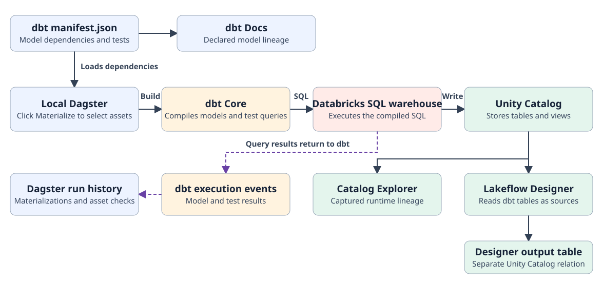

# Retail lineage POC

One dbt Core project models fictional retail orders on an Azure Databricks SQL warehouse. The POC compares the logical graph in dbt Docs and local Dagster, runtime lineage in Unity Catalog, reuse in Lakeflow Designer, and a single native dbt task in Lakeflow Jobs.

Use an authenticated Databricks CLI profile and a Unity Catalog sandbox. Replace the workspace, warehouse and profile placeholders, and substitute your catalog for `sandbox_catalog`. Run only one builder at a time against the POC schema.


[](docs/execution-flow.svg)

**Run results:** Databricks returns query results to dbt. dbt streams model and test events back to Dagster, where they appear as asset materializations and checks.

**Lineage and reuse:** dbt Docs renders the declared model graph from the manifest. Catalog Explorer displays the runtime lineage Databricks captures. Lakeflow Designer can read the built tables and write a separate output. Terminal dbt and a native Lakeflow dbt task can also launch the same dbt build.

## 1. Install and configure

From the repository root in PowerShell with Python 3.11 installed:

```powershell
git clone https://github.com/wittyvenugopal/databricks-dbt-dabster-lineage.git
cd databricks-dbt-dabster-lineage
py -3.11 -m venv .venv
.venv\Scripts\Activate.ps1
python -m pip install -r requirements.txt
Copy-Item dbt_project/profiles.yml.example dbt_project/profiles.yml
```

On macOS/Linux, use `python3.11 -m venv .venv` and `source .venv/bin/activate`, then run `python -m pip install -r requirements.txt` and `cp dbt_project/profiles.yml.example dbt_project/profiles.yml`.

1. Run `databricks auth describe --profile '<cli-profile>'`. If the OAuth session has expired, run `databricks auth login --profile '<cli-profile>' --host https://<workspace-hostname>`.
2. In the same workspace, open **SQL Warehouses** and choose an approved Unity Catalog-enabled warehouse you can use. Copy the **Server Hostname** and **HTTP Path** from **Connection details**. For the native Jobs experiment, use a Pro or Serverless SQL warehouse.
3. Set the following in the shell that will launch both dbt and Dagster. The example `.env.example` lists the variables. Setting them in the shell makes them available to subprocesses.

```powershell
$env:DATABRICKS_HOST = '<workspace-hostname>'
$env:DATABRICKS_HTTP_PATH = '/sql/1.0/warehouses/<warehouse-id>'
$env:DATABRICKS_CATALOG = 'sandbox_catalog'
$env:DATABRICKS_SCHEMA = 'dbt_lineage_poc'
```

For the default dbt target, load a short-lived OAuth access token from the CLI profile into the shell without printing it:

```powershell
$env:DATABRICKS_AUTH_TYPE = 'pat'
$env:DATABRICKS_TOKEN = (databricks auth token '<cli-profile>' --output json | Out-String | ConvertFrom-Json).access_token
if (-not $env:DATABRICKS_TOKEN) { throw 'No CLI OAuth access token was returned.' }
```

The adapter sends this token as a bearer credential. The SDK calls its token provider `pat` and accepts the CLI access token through the same field. Refresh the token before the experiments if needed. Restart Dagster after refreshing so its processes inherit the new token.

For browser-based dbt OAuth, set `target: oauth` in the local `profiles.yml` and clear the token environment variables. Complete browser sign-in with the same workspace identity. If your organisation permits PATs, keep the default token target and use `$env:DATABRICKS_TOKEN = Read-Host -MaskInput 'Databricks token'` in PowerShell 7 instead of obtaining a CLI token. Keep credentials out of Git and close the shell when finished. [Databricks dbt Core authentication](https://docs.databricks.com/aws/en/partners/prep/dbt)

Local validation used Python 3.11.14, dbt Core and dbt Databricks 1.10.15, Dagster and its webserver 1.12.6, and dagster-dbt 0.28.6. See [FINDINGS.md](FINDINGS.md) for the scope of validation.

## 2. Parse locally and inspect dependencies

Use the repository root for all commands. For an offline parse, use the default token target and set the catalog and schema as shown above. In a separate shell, set `DATABRICKS_HOST=example.invalid`, `DATABRICKS_HTTP_PATH=/sql/1.0/warehouses/offline`, `DATABRICKS_AUTH_TYPE=pat` and `DATABRICKS_TOKEN=offline-placeholder`. Use the real connection values for all warehouse commands.

```powershell
dbt parse --project-dir dbt_project --profiles-dir dbt_project
python scripts/inspect_manifest.py
```

`target/manifest.json` contains dbt's declared nodes, dependencies, materialisations, tests and macros. The script prints each model and its immediate declared parents.

## 3. Run the baseline after approval

1. Open **Catalog** in the sandbox and check for `dbt_lineage_poc` under `sandbox_catalog`. If it is absent, open **SQL Editor**, select the approved warehouse, and run the statement below with an identity that has `CREATE SCHEMA` on the catalog.

   ```sql
   create schema if not exists sandbox_catalog.dbt_lineage_poc;
   ```

2. Confirm the schema is dedicated to this POC before building. The build identity needs warehouse **CAN USE**, `USE CATALOG`, `USE SCHEMA`, and permissions to create and update its sandbox tables and views.
3. Run the following commands. Save the build results immediately after the build, even if the build reports failures.

   ```powershell
   dbt debug --project-dir dbt_project --profiles-dir dbt_project
   dbt build --project-dir dbt_project --profiles-dir dbt_project
   Copy-Item dbt_project/target/run_results.json dbt_project/target/build_run_results.json
   dbt docs generate --project-dir dbt_project --profiles-dir dbt_project
   dbt docs serve --project-dir dbt_project --profiles-dir dbt_project
   ```

The expected build creates three seed tables, three staging views and three mart tables. dbt inlines `int_order_details` as a CTE. `dbt build` runs the seeds, models and data tests in dependency order.

The files under `dbt_project/target` serve different purposes. `manifest.json` describes the project. `run_results.json` records statuses, timings and messages for a specific invocation. `catalog.json` records warehouse metadata such as relation types and column types after Docs generation.

Open **http://localhost:8080**, use the **Lineage Graph** control to inspect the project DAG, then open `fct_sales` and use its graph to trace upstream to `int_order_details`, the staging views and seeds. Use the graph controls to expand parents and children. Open `int_order_details` to compare its downstream marts. Record the graph and build evidence in [FINDINGS.md](FINDINGS.md).

## 4. Inspect Unity Catalog lineage

1. In **Catalog**, browse to `sandbox_catalog` → `dbt_lineage_poc` → `fct_sales`. Open **Lineage** → **See Lineage Graph**. Expand upstream nodes and inspect the edge details.
2. Repeat for `dim_customers` and `daily_revenue`. Open a mart column's lineage where available and trace `gross_amount` or `revenue` back to the inputs.
3. Run the two queries in [sql/unity_catalog_lineage.sql](sql/unity_catalog_lineage.sql) in **SQL Editor**. Adjust the date window for the actual run. Record missing edges and any access restrictions separately.

The manifest captures declared `ref()` dependencies. Unity Catalog captures supported runtime interactions between physical relations, including views and tables, and can expose source-to-target column mappings. View expansion can change which edges appear. The ephemeral CTE has no standalone relation. Tests can read objects, and macros can generate expressions, but neither is represented as a first-class dbt node in Unity Catalog lineage. [Azure Databricks lineage](https://learn.microsoft.com/en-us/azure/databricks/data-governance/unity-catalog/data-lineage)

## 5. Explore Dagster locally

In the configured shell from the repository root:

```powershell
New-Item -ItemType Directory -Force .dagster | Out-Null
$env:DAGSTER_HOME = (Resolve-Path .dagster).Path
dbt parse --project-dir dbt_project --profiles-dir dbt_project
dagster dev -f orchestration/definitions.py
```


1. Visit **http://localhost:3000** → **Assets** → **Asset Catalog** or the global asset graph. Open a mart and expand its upstream and downstream graph. The definitions load from the manifest before a run. Look for the staging-to-mart edges where Dagster traverses the ephemeral model.
2. After workspace execution is approved, materialise all POC assets. Open the run and inspect dbt logs, individual materialisation events and **Checks** on the staging assets. Compare against the standalone dbt build. Dagster records events from its own runs and does not automatically import the external build history.
3. Select `fct_sales` plus its upstream assets in the graph, then materialise the selection. Confirm the run's selected assets and that unrelated marts were not materialised. The dbt CLI equivalent is `dbt build --select +fct_sales` with the same project and profile flags.
4. To test failure, save the original `stg_orders.sql` and temporarily replace only `cast(quantity as int) as quantity` with `cast(non_existing_column as int) as quantity`. Stop Dagster, reparse, restart it, and materialise all POC assets. Record the dbt error and which nodes succeeded, failed or skipped. Check whether independent branches ran. A failed update may leave an older table or view in place, so use the current run events as evidence.
5. Restore the original SQL, stop Dagster, reparse, restart and rerun. Verify the restored model and downstream marts have successful materialisations and inspect their test results.

## 6. Designer, native Jobs and findings

- [Lakeflow Designer walkthrough](docs/visual_data_prep.md)
- [Native Lakeflow Jobs walkthrough](docs/databricks_jobs.md)
- [Validation checklist and findings](FINDINGS.md)

## 7. Lab experiment — build a policy fact

Follow the [policy lab walkthrough](dbt-lineage-poc-pilot/README.md). Create a separate sandbox schema, load the fictional customer, policy and quote seeds, then build `fct_policy`. Confirm its four expected rows, inspect its three upstream branches, and rerun the selection through local Dagster.