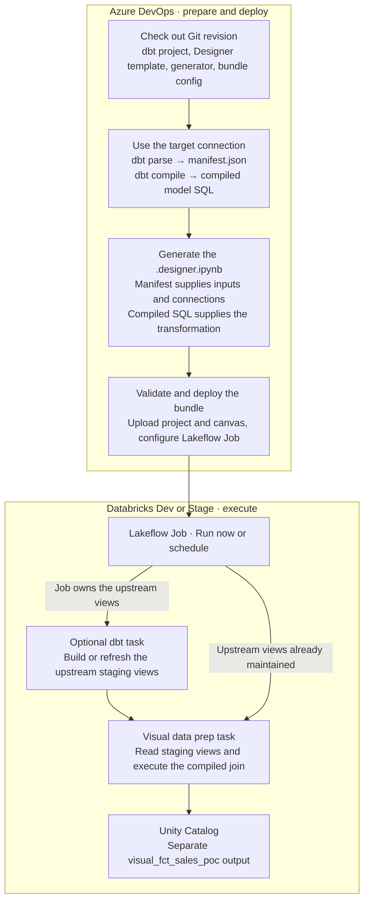
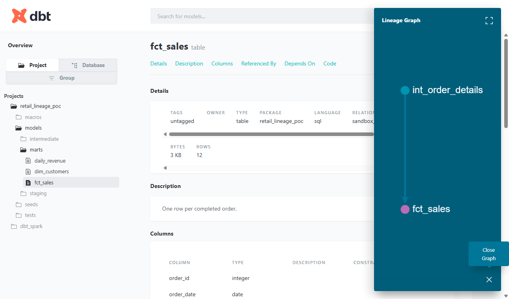
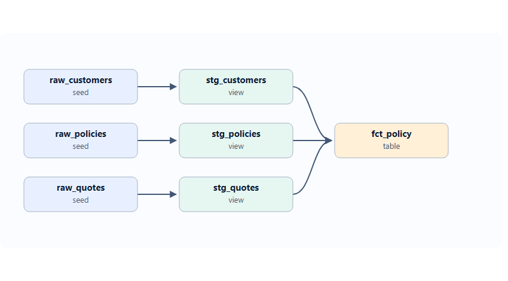
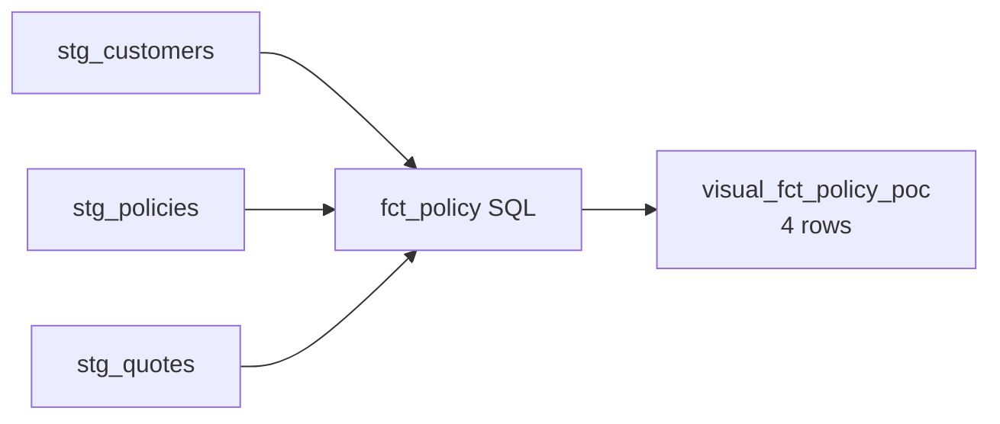

# Release a dbt-backed Designer canvas

This release design deploys the same Git revision to Dev and Stage with each environment's own workspace, catalog, schema and warehouse. The POC verified canvas generation, import and Serverless execution. Azure DevOps and bundle deployment are the proposed release path.

## From source control to a workspace



Deployment uploads code and configures the job. It does not refresh the input views. Configure the deployed job with the runtime path that matches who owns those inputs.

| Input ownership | Lakeflow job |
|---|---|
| Another job builds and refreshes the staging views | Run the Designer task alone. |
| This job owns its staging inputs | Run `dbt build --select +stg_orders +stg_customers +stg_products`, then run the canvas on success. |
| This job also publishes or compares the original dbt mart | Run `dbt build --select +fct_sales`, then run the canvas. |

## Prepare the canvas on the Azure DevOps agent

1. Configure the target's dbt profile and warehouse connection. Use a federated pipeline identity where available.
2. In Designer, export a separate **Source → SQL → Output** template using **File → Export**. Keep the exported file in private release inputs or an approved artifact store. The experiment used the exported notebook's operator metadata and generated code.
3. From the repository root, use this sequence in a Bash task or run the equivalent commands on your development machine:

```bash
dbt parse --project-dir dbt_project --profiles-dir dbt_project
dbt compile --select fct_sales --project-dir dbt_project --profiles-dir dbt_project
mkdir -p generated
python scripts/generate_designer_canvas.py \
  "$DESIGNER_TEMPLATE" \
  dbt_project/target/manifest.json \
  dbt_project/target/compiled/retail_lineage_poc/models/marts/fct_sales.sql \
  generated/Retail_manifest_canvas_poc.designer.ipynb \
  --pilot retail
```

Set `DESIGNER_TEMPLATE` to the path of your exported template. Pass a manifest and compiled SQL from the same release and target. The generator follows the ephemeral `int_order_details` dependency to the three staging views, preserves its inlined CTE, and writes to `visual_fct_sales_poc` in the model's target catalog and schema. This experiment supports the two included projects and the tested three-operator template shape.

## Deploy and run

1. Define Dev and Stage targets in `databricks.yml`. Include the dbt project source and generated canvas in bundle sync. Keep local profiles and raw exports out of the bundle.
2. Configure the Designer task as a `notebook_task` pointing to the generated `.designer.ipynb`. If the job owns the inputs, add the native `dbt` task and set the Designer task's `depends_on` to its task key.
3. Run `databricks bundle validate -t dev` and `databricks bundle deploy -t dev`. Use the Stage target after its approval gate. Choose the target warehouse and a job identity with the required catalog, schema and table access.
4. Use **Jobs & Pipelines → Run now** or `databricks bundle run -t dev <job-key>`. Open the Designer task run and inspect its operators. Check the output table and its Catalog Explorer lineage.

[Azure Databricks CI/CD](https://learn.microsoft.com/en-us/azure/databricks/dev-tools/ci-cd/) · [Designer bundle deployment](https://learn.microsoft.com/en-us/azure/databricks/designer/production) · [Native dbt task](https://learn.microsoft.com/en-us/azure/databricks/jobs/dbt)

## Verified results

| Model | Generated canvas | Verified output |
|---|---|---|
| `fct_policy` | Three Sources, joined SQL and one Output | Serverless Job and interactive Designer run succeeded. Four rows and zero differences versus dbt. Catalog Explorer showed the canvas as both upstream and downstream of the output table. |
| `fct_sales` | Three Sources reached through the ephemeral model, compiled SQL containing the CTE, and one Output | Serverless Job succeeded. Twelve rows and zero differences versus dbt. Interactive Designer and output lineage were not verified for this generated retail canvas. |





The policy canvas wiring below is redrawn from the observed Designer screenshot. The output preview showed four rows.



[Full POC findings](../FINDINGS.md)
